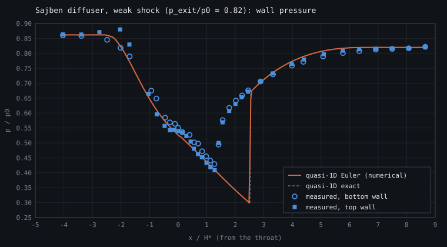
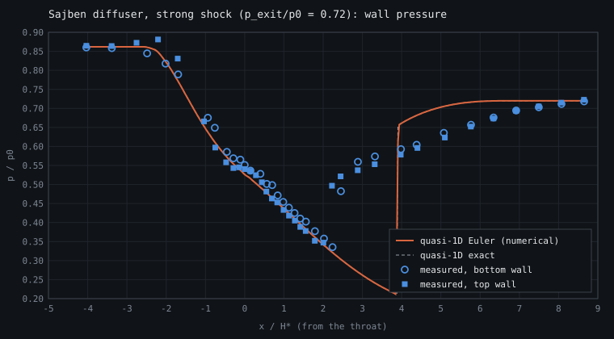

# Euler Laboratory

A self-contained compressible-flow lab for the Euler equations — shock tubes, quasi-1D nozzles, a reflected-shock-tube facility designer, and 2D Cartesian flows on a shared finite-volume engine. Real gases in SI units (air, N₂, O₂, Ar, He, H₂, CO₂, combustion products; γ = γ(T) from NASA polynomials), JSON case files, CSV output, a headless command-line runner, and built-in verification (order of accuracy, grid convergence index). No build step, no dependencies, no server.

## Quickstart in 30 seconds

**▶ [Open the live demo](https://mehdiansari-cfd.github.io/cfdsolver/)** — nothing to install; pick a preset and hit *run*.

Or run it locally:

```bash
git clone https://github.com/mehdiansari-cfd/cfdsolver.git
cd cfdsolver
# then just open the HTML files in a browser:
open index.html        # shock tube, nozzle, facility, verify   (macOS; `start` on Windows, `xdg-open` on Linux)
open index2d.html      # 2D Cartesian

# or headless, from scripts and parameter sweeps (Node ≥ 18, nothing to install):
node run.js cases/air-shocktube.json
node run.js cases/nozzle-m2.json --sweep pb=24000,150000,200000,280000
```

That's the whole setup. Each page loads React and Babel-standalone from a CDN, then the solver math, and renders. There is no toolchain, no `npm install`, no bundler.

<!-- HERO — see docs/CAPTURE.md; uncomment once docs/hero.png is recorded.

-->

<!-- GIFS — see docs/CAPTURE.md; uncomment once the recordings exist.
| Sod shock tube | Choked CD nozzle | Kelvin–Helmholtz (2D) |
|:--:|:--:|:--:|
|  |  |  |
-->

> **Screenshots & GIFs are coming.** [`docs/CAPTURE.md`](docs/CAPTURE.md) lists exactly which presets and frames to record; once the files land in `docs/`, uncomment the blocks above.

## What's inside

- **Real gases, SI units** — pick air, N₂, O₂, Ar, He, H₂, CO₂ or frozen CH₄–air / H₂–air products; calorically perfect (γ fixed at 298 K) or thermally perfect (γ = γ(T), NASA-7 polynomials). The legacy non-dimensional ideal gas (γ, R = 1) is still there for the textbook problems.
- **1D shock tube** — the Riemann problem with one gas or two (driver / driven), against an exact real-gas Riemann solution.
- **Quasi-1D nozzle** — analytic or tabulated (CSV) area profiles, a stagnation reservoir and a back pressure; compared with the exact steady quasi-1D solution in every regime, including the location of a normal shock. Measured p/p₀ data can be overlaid.
- **Shock-tube facility** — design a reflected-shock tube: driver/driven gases, fill pressures and lengths → incident and reflected shock conditions (states 1–5), tailoring, test time, the p₄ for a target Mₛ, and an x–t wave diagram from a two-gas simulation.
- **Verification and validation** — order-of-accuracy studies and grid convergence index (GCI) error bars, in the browser and from Node; comparison with the Sajben transonic-diffuser experiment (NPARC data).
- **Case files and CLI** — save / load JSON cases, export CSV, and run any case headless with `node run.js`, including parameter sweeps.
- **2D Cartesian** — full 2D Euler on a Cartesian grid (non-dimensional), with the radial Sod problem, the Lax–Liu four-quadrant Riemann (config 3), the Sedov point blast and the Kelvin–Helmholtz instability.

All modules share four selectable Riemann fluxes, MUSCL reconstruction and SSP-RK2 time integration. The math lives in `gas.js`, `solver.js`, `nozzle.js`, `facility.js`, `verify.js` and `solver2d.js` as pure modules with no DOM coupling, so you can also `require` them from Node for headless experiments, convergence studies, or test scripts.

## Who it's for

**For students.** Land on the [live demo](https://mehdiansari-cfd.github.io/cfdsolver/), click a preset (start with Sod) — it solves immediately — then hit *play* or drag the timeline. Toggle the *exact overlay* to see how close the numerical solution gets, then switch the *flux* dropdown between HLLC, HLL, Roe, and Rusanov to watch a contact discontinuity sharpen or smear. The nozzle tab makes choking and shock-in-nozzle behaviour tangible; the 2D tab shows how a radial shock or a shear layer evolves. No setup stands between you and the physics.

**For researchers / instructors.** The solvers are DOM-free CommonJS modules, so you can drive them headlessly from Node for convergence studies, order-of-accuracy checks against the exact Riemann and isentropic references, or as a scratchpad for a new flux or limiter. The [Programmatic API](#programmatic-api) section shows the entry points; [`test.js`](test.js) is a worked example (see [Validation](#validation)). Because everything is a few hundred lines of readable JavaScript with no build step, it's easy to fork, instrument, and drop a new scheme into the `FLUXES` table.

---

## What it solves

The 1D Euler equations for an ideal gas, `p = ρRT`, either calorically perfect (constant cₚ) or thermally perfect (cₚ = cₚ(T), so γ = γ(T)). In SI units with a real gas, or non-dimensional with γ and R = 1 for the classic test problems.

**Shock tube** (uniform area):

```
dU/dt + dF(U)/dx = 0,    U = [ρ, ρu, E (, ρY)],    E = ρ e(T) + ½ρu²
```

where `e(T) = h(T) − RT` comes from the gas model, and the optional `ρY` row carries the driver-gas mass fraction for two-gas runs.

with a Riemann initial condition — two constant states separated by a diaphragm at `x = x₀`. At `t = 0` the diaphragm bursts and the resulting wave pattern (some combination of shocks, rarefactions, and a contact discontinuity) is evolved on a finite-volume grid.

**Quasi-1D nozzle** (variable area `A(x)`):

```
dU/dt + dF(U)/dx = H,    H = -(1/A) (dA/dx) · [ρu, ρu², u(E+p)]
```

driven by a stagnation reservoir `(p₀, T₀)` at the inlet (velocity extrapolated from the interior, temperature and pressure fixed by the stagnation state) and a static back pressure `p_b` at the exit (switching automatically between subsonic and supersonic behaviour as the local exit Mach crosses unity). Time-marched to steady state.

**2D Cartesian** (full two-dimensional Euler):

```
dU/dt + dF(U)/dx + dG(U)/dy = 0,    U = [ρ, ρu, ρv, E]
F = [ρu, ρu² + p, ρuv,     u(E+p)]
G = [ρv, ρuv,     ρv² + p, v(E+p)]
```

solved on a uniform Cartesian grid with transmissive (zero-gradient) boundaries on all four walls. The 1D Riemann solvers are extended to 2D by carrying the tangential momentum as a passive scalar across the wave pattern (the rotational invariance of the Euler equations makes this exact for axis-aligned faces).

---

## Validation

The solvers ship with a zero-dependency verification suite. Run it with:

```bash
node test.js
```

It uses only Node's built-in modules — no test framework, no dev-dependencies — and [CI runs it on every push and pull request](.github/workflows/test.yml). 27 checks in about a minute and a half:

| Area | What is checked |
|------|-----------------|
| Accuracy | Sod vs exact Riemann: L1 ≈ 1.5×10⁻³ at N = 800, decreasing under refinement |
| Positivity | ρ, p > 0 on the 1D strong shock (10⁵ pressure ratio) and the 2D Sedov blast |
| Conservation | mass and energy to ~10⁻¹⁶ (ideal gas) and ~10⁻¹⁴ (real gases, two gases) |
| Gas data | cₚ(298 K) vs JANAF for N₂, O₂, Ar, H₂, CO₂ (0.1%); air R = 287.05, γ = 1.400 (298 K), 1.336 (1000 K); thermo inverses |
| Real-gas exact Riemann | reproduces the ideal-gas exact solver on all five presets (5×10⁻⁵); calorically perfect limit reproduces the normal-shock T₂ formula |
| Real-gas numerics | thermally perfect air and two-gas He → air (Mₛ ≈ 4.1) vs exact, every flux |
| Nozzle | choked mass flow vs theory; exact quasi-1D solution incl. the normal-shock position (within 2 cells) and an SI air M2 tunnel (ṁ to 0.2%); PCHIP area tables |
| Facility | shock-tube equation, p₅/p₂ and the Mr–Mₛ relation to 10⁻⁶; a two-gas simulation reproduces the reflection time, p₅ and T₅ to < 1% and the under-tailored pressure rise |
| Case files / CLI | validation messages; `node run.js` output, `--set`, `--sweep` |
| Verification | GCI recovers p = 2; smooth-wave L1 order > 1.8; GCI bands contain the exact answer |
| Validation | Sajben diffuser: pressure ahead of the shock and in the recovered flow match the NPARC data; inviscid shock lies aft of the measured one |

### Verification: order of accuracy and grid convergence index

Matching Sod shows the code is coded correctly; it does not say how large the discretisation error is in a given answer. [`verify.js`](verify.js) (and the **Verify** tab) adds:

- **Order of accuracy** on a smooth periodic density wave, where the design order shows: L1 order 1.89 on the finest pair (MUSCL + SSP-RK2 is second order; minmod clips extrema, so L∞ stays near 1.3). Sod by contrast converges at L1 ≈ 0.85, because discontinuities cap every scheme near first order.
- **Grid convergence index** — the three-grid procedure of Celik et al. (*J. Fluids Eng.* 130, 2008): apparent order, Richardson extrapolation and a GCI error band. On three test quantities the exact answer falls inside the band:

  | Quantity (grids 100 / 200 / 400) | Fine grid | Extrapolated | Exact | GCI |
  |---|---|---|---|---|
  | Normal-shock position, CD nozzle | 0.81824 | 0.81655 | 0.81634 | ±0.26% |
  | Unchoked nozzle mass flow | 0.49287 | 0.48242 | 0.48196 | ±2.7% |
  | Real-gas shock-tube plateau ρ₂ [kg/m³] | 2.37727 | 2.37781 | 2.37689 | ±0.03% |

### Validation against experiment: the Sajben transonic diffuser

Verification shows the equations are solved right; validation shows how well they describe real hardware. [`validation/sajben.js`](validation/sajben.js) compares the quasi-1D nozzle (thermally perfect air) with the wall pressures measured in the Sajben transonic diffuser, using the unmodified data files from the NPARC Alliance Validation Archive (conditions T₀ = 300 K, p₀ = 121 kPa, p_exit/p₀ = 0.82 and 0.72).

| Weak shock (p_exit/p₀ = 0.82) | Strong shock (p_exit/p₀ = 0.72) |
|:--:|:--:|
|  |  |

| Case | RMS Δ(p/p₀) ahead of the shock | Shock x/H*: computed vs measured | RMS Δ(p/p₀) in the recovered flow |
|------|------|------|------|
| weak  | 0.02 | 2.53 vs 1.35–1.49 | 0.01 |
| strong | 0.02 | 3.89 vs 2.12–2.35 | 0.03 |

The isentropic acceleration through the throat and the recovered exit pressure match the measurements to about 2% of p₀. **The shock is predicted 1.0–1.8 throat heights too far downstream**, with a sharper jump than measured: an inviscid quasi-1D model has no boundary layer, while in the experiment the displacement thickness (and, in the strong case, shock-induced separation) shrinks the effective area and pulls the shock upstream. The numerical shock agrees with the exact quasi-1D solution to 0.02 H*, so this gap is the model's, not the discretisation's — exactly the kind of limit a validation case is meant to expose. Details in [`validation/sajben/README.md`](validation/sajben/README.md); the cases are in [`cases/sajben-weak.json`](cases/sajben-weak.json) / [`cases/sajben-strong.json`](cases/sajben-strong.json), and the measurements can be overlaid in the Nozzle tab with **Load p/p₀ CSV** ([`cases/sajben-weak-measured.csv`](cases/sajben-weak-measured.csv)).

See [`test.js`](test.js) for the exact tolerances and setups, and [`CONTRIBUTING.md`](CONTRIBUTING.md) for how to add a case.

---

## Gases and units

[`gas.js`](gas.js) provides per-unit-mass gas models in SI: `R`, `cₚ(T)`, sensible enthalpy `h(T)` and the entropy function `φ(T) = ∫cₚ/T dT`; everything else (e, γ, a, T from e or h, isentropes, stagnation states) derives from those.

| Gas | Composition | γ at 298 K |
|-----|-------------|-----------|
| Air (dry) | N₂ 78.084, O₂ 20.946, Ar 0.934, CO₂ 0.036 % (mole) | 1.400 |
| N₂, O₂, Ar, He, H₂, CO₂ | pure species | 1.400, 1.395, 1.667, 1.667, 1.405, 1.289 |
| CH₄–air products | CO₂ + 2 H₂O + 7.52 N₂ (φ = 1, frozen) | 1.371 (1.252 at 2000 K) |
| H₂–air products | H₂O + 1.88 N₂ (φ = 1, frozen) | 1.372 (1.251 at 2000 K) |

- **Data:** NASA 7-coefficient polynomials, 200–6000 K (McBride, Gordon & Reno, NASA TM-4513, 1993, as distributed with Cantera). Outside that range cₚ is held constant. Fixed-composition mixtures fold into a single NASA-7 fit.
- **Models:** *thermally perfect* (γ = γ(T)) or *calorically perfect* (cₚ frozen at 298.15 K).
- **Limits:** composition is frozen — no dissociation, ionisation or reaction. Above roughly 2500 K real air and combustion gases dissociate and these models over-predict temperature; the UI warns when that happens. Combustion products are complete-combustion compositions, useful for γ(T) and R, not for chemistry.
- **Units:** SI throughout the math layer and case files (Pa, K, m, s, kg); the UI shows kPa, ms and cm² where that reads better.
- **Two gases:** different left / right gases run as a binary mixture carrying a transported mass fraction. Conservative two-gas schemes produce small spurious pressure oscillations where the interface is smeared (Abgrall 1996): expect a few-percent blip when a wave crosses it.

## Shock-tube facility module

[`facility.js`](facility.js) — ideal shock-tube theory for real gases, built from the exact Riemann solver:

1. diaphragm burst → incident shock Mₛ and speed W, shocked test gas (2), expanded driver (3);
2. reflection at the end wall → reflected shock (Mr) and the stagnant test gas (5);
3. reflected shock meets the contact → the wave sent back to the end wall decides **tailoring** (tailored / under-tailored = shock / over-tailored = expansion) and when the test ends;
4. the expansion head reflected from the driver end wall, integrated through the exact fan.

It reports states 1–5, Mₛ, Mr, p₅, T₅, test time and what limits it, solves for the p₄ that gives a target Mₛ (`facilityDesignP4`), and draws the x–t wave diagram. The **Facility** tab overlays these analytic wave paths on the x–t diagram of a two-gas simulation and plots end-wall pressure and temperature histories.

Checks: in the calorically perfect limit it reproduces the shock-tube equation, p₅/p₂ and the Mr–Mₛ relation to 10⁻⁶; for He → N₂ at Mₛ = 4.2 the two-gas simulation matches the reflection time, p₅ and T₅ to better than 1%, and shows the under-tailored pressure rise when the contact-reflected shock arrives. Ideal theory assumes an instant diaphragm burst and no boundary layer; real test times are shorter.

| Preset | Driver → driven | p₄ / p₁ | Mₛ | T₅ |
|--------|-----------------|---------|----|----|
| He → N₂, tailored | He 376 kPa → N₂ 5 kPa | 75 | 3.34 | 1564 K |
| He → Ar, kinetics | He 140 kPa → Ar 5 kPa | 28 | 2.80 | 1906 K |
| H₂ → N₂ | H₂ 351 kPa → N₂ 5 kPa | 70 | 4.00 | 2077 K |
| air → air, weak | air 50 kPa → air 10 kPa | 5 | 1.40 | 460 K |

## Case files and the command line

Every workspace can **Save case** (JSON), **Load case** and **Export CSV**. A case saved in the browser runs unchanged from Node:

```bash
node run.js case.json [--out DIR] [--set key=value]... [--sweep key=v1,v2,...] [--area profile.csv] [--quiet]
```

- `--set numerics.N=800 --set pb=2e4` overrides fields (dotted paths).
- `--sweep pb=24000,150000,280000` runs once per value and writes `<name>.sweep.csv` with the scalar outputs (mass flow, exit Mach, regime, Mₛ, p₅, T₅, test time …).
- `--area profile.csv` reads a two-column x, A table for the nozzle.
- Each run writes `<name>.csv` (fields with SI units), `<name>.exact.csv` when a reference exists, snapshots and probe histories when the case asks for them, and `<name>.summary.json`.
- Nozzle cases can run to steady state instead of a fixed time: `"steady": { "tol": 1e-5, "tMax": 0.5 }`.

Example cases are in [`cases/`](cases/); the case format is documented at the top of [`case.js`](case.js).

---

## Shock-tube module

**Four approximate Riemann solvers**, switchable from a dropdown without restarting:

- **HLLC** — three-wave estimate with a contact wave; sharp on contact discontinuities.
- **HLL** — two-wave estimate; simple and robust, smears contacts.
- **Roe** — linearised solver on the Roe-averaged state, with a Harten entropy fix on the genuinely nonlinear fields.
- **Rusanov** (local Lax-Friedrichs) — maximally dissipative one-wave estimate; the safety net.

**Second-order in space and time.** MUSCL reconstruction with a minmod slope limiter gives second-order spatial accuracy where the solution is smooth and drops to first order at extrema (TVD). Time integration is SSP-RK2 (Shu-Osher) with an adaptive CFL-limited time step.

**Exact Riemann reference.** A Newton iteration on the star pressure plus full self-similar wave-structure sampling gives the analytical solution at the current time. Toggle "exact overlay" to draw it as a dashed grey curve on every plot — solver error becomes visible at a glance.

**Two boundary conditions.** Transmissive (zero-gradient) or reflective (mirror with sign flip on momentum). The exact overlay auto-disables for reflective BCs, since the analytical solution assumes an infinite domain.

**Four tube views.** The horizontal "inside the tube" strip can render density, schlieren-style `|∂ρ/∂x|`, pressure, or Mach number through a warm cream → rust colormap, with a colour bar.

**Scalar plots.** ρ, u, p, T, plus (toggleable) Mach number, internal energy, entropy, sound speed and, for real gases, γ(T) and the driver-gas mass fraction. Non-dimensional runs use T = p/ρ (R = 1) and s = ln(p/ρ^γ); SI runs use kelvin, kPa and J/(kg·K).

**Live, scrubbable runs.** *Solve* computes in small time-budgeted slices between animation frames, so the page never freezes and the view follows the solution as it develops. Every run is recorded, so *play* replays it at a steady 60 fps (0.25×–4×) and the timeline scrubs to any moment. A few hundred Lagrangian tracer particles drift with the local velocity field during playback.

**Linked probe.** Hovering any plot or the field view puts a cursor at that position in every panel and reads out ρ, u, p, M, T there.

**Presets.** The five classic non-dimensional problems (Sod, Lax, 1-2-3, strong shock, blast wave), plus SI cases: air 10:1 bar, He driving air (two gases, Mₛ ≈ 4.1) and hot CO₂, where γ(T) visibly matters.

---

## Numerical methods at a glance

| Stage              | Scheme                                              |
|--------------------|-----------------------------------------------------|
| Spatial discretisation | Finite-volume, cell-centred, 2 ghost cells per side; 1D in `solver.js` / `nozzle.js`, 2D Cartesian in `solver2d.js` |
| Reconstruction     | MUSCL with minmod slope limiter (piecewise linear); independent x- and y-slopes in 2D |
| Riemann solver     | HLLC / HLL / Roe / Rusanov (selectable); 2D version carries tangential momentum as a passive scalar |
| Time integration   | SSP-RK2 (two-stage, strong-stability-preserving)    |
| Time step          | 1D: Δt = CFL · Δx / max(|u| + a). 2D: Δt = CFL · min(Δx, Δy) / max(|u| + |v| + a). Recomputed each step. |
| Boundary conditions| Shock tube: transmissive, reflective or periodic. Nozzle: reservoir `(p₀, T₀)` inlet + static back-pressure exit (with auto sub/supersonic switch). 2D: transmissive on all four walls. |
| Equation of state  | Ideal gas p = ρRT; calorically or thermally perfect (NASA-7 cₚ(T)); T recovered from e by Newton iteration; two gases via a transported mass fraction. Legacy non-dimensional γ-law path unchanged. |

---

## Shock-tube test problems

| Preset         | Left (ρ, u, p)        | Right (ρ, u, p)       | t_end | Notes |
|----------------|-----------------------|-----------------------|-------|-------|
| Sod            | (1.000, 0.0, 1.0)     | (0.125, 0.0, 0.1)     | 0.20  | Mild left rarefaction + contact + right shock. |
| Lax            | (0.445, 0.698, 3.528) | (0.500, 0.0, 0.571)   | 0.16  | Asymmetric, stronger contact. |
| 123 problem    | (1.000, −2.0, 0.4)    | (1.000, 2.0, 0.4)     | 0.15  | Two strong rarefactions, near vacuum at the centre. |
| Strong shock   | (1.000, 0.0, 1000.0)  | (1.000, 0.0, 0.01)    | 0.012 | Stress test for the flux limiter. |
| Blast wave     | (1.000, 0.0, 0.01)    | (1.000, 0.0, 100.0)   | 0.035 | Mirrored stress test. |

γ = 1.4 (air), diaphragm at x₀ = 0.5, domain L = 1.0 by default.

---

## Nozzle module

Quasi-1D Euler in a duct with cross-section `A(x)`, for any gas. The flux divergence is reused unchanged from `solver.js` (so all four Riemann solvers, MUSCL, and SSP-RK2 carry over); on top of that, `nozzle.js` adds the geometric source term, the reservoir / back-pressure boundary closures, and the exact steady quasi-1D reference.

**Area profiles** — three analytic families with area ratio `AR = A_max / A_throat` (`A_throat = 1` non-dimensional, or `Athroat` in m²), or a table:

- **Convergent** — quadratic taper from `A(0) = AR` down to `A(L) = 1`.
- **Divergent** — quadratic flare from `A(0) = 1` out to `A(L) = AR`.
- **CD** (convergent–divergent) — symmetric parabola with the throat at `x = L/2`.
- **Table** — any measured or designed profile `(x, A)` from a CSV file, interpolated with monotone cubic Hermite splines (Fritsch–Carlson), so dA/dx is continuous and never overshoots.

**Boundary conditions** — physically motivated rather than zero-gradient:

- **Inlet:** isentropic reservoir at `(p₀, T₀)`. One characteristic leaves through a subsonic inlet, so the velocity is extrapolated from the first interior cell; the two incoming ones fix the stagnation state, giving `h(T) = h(T₀) − u²/2` and `p = p₀ exp((φ(T) − φ(T₀))/R)` (for a calorically perfect gas, `T = T₀ − u²/(2cₚ)` and `p = p₀(T/T₀)^{γ/(γ−1)}`). Total pressure and enthalpy enter at exactly `(p₀, T₀)`, so the nozzle chokes at the theoretical mass flow once the throat reaches `M = 1`.
- **Exit:** static back pressure `p_b` when the exit is subsonic; full extrapolation when the exit is supersonic. The switch is driven by the local exit Mach, so a CD nozzle can transition through choked → shock-in-divergent → fully supersonic without changing the BC code.

**Exact quasi-1D reference** (`quasi1DSolution`). For any gas, the steady solution is built from the isentrope `u = √(2(h₀ − h))`, mass flux `G = ρu` and its sonic maximum `G*`. From the back pressure it picks the regime: unchoked (A* from the exit pressure), choked with a **normal shock** located by matching the exit pressure behind it (real-gas Rankine–Hugoniot), or shock-free supersonic. The numerical shock lands within two cells of it, and ṁ agrees to ~0.06% in choked flow. In weakly unchoked, low-Mach flow the steady ṁ is very sensitive to the exit pressure (a 0.2% pressure difference moves it ~3% at N = 300), so use the GCI study to put an error bar on it.

### Nozzle test problems

| Preset             | Type       | AR  | p_b / p₀ | Regime (exact) | Notes |
|--------------------|------------|-----|----------|----------------|-------|
| Subsonic CD        | CD         | 2.0 | 0.97 | unchoked | Venturi regime, isentropic acceleration then deceleration. |
| Choked CD          | CD         | 2.0 | 0.93 | normal shock | Throat at M = 1, a weak shock just past it, then subsonic recompression. |
| Normal Shock       | CD         | 2.0 | 0.75 | normal shock | Shock stands at x ≈ 0.816 L in the divergent section. |
| Full Supersonic CD | CD         | 2.0 | 0.09 | supersonic | Design-point expansion to M ≈ 2.2 at the exit. |
| Convergent         | convergent | 3.0 | 0.60 | unchoked | Accelerates to M ≈ 0.89 at the exit. |
| Divergent          | divergent  | 2.5 | 0.10 | supersonic | Supersonic expansion from a sonic inlet plenum. |
| Air tunnel M2 (SI) | CD         | 1.6875 | 0.08 | supersonic | Thermally perfect air, p₀ = 300 kPa, T₀ = 300 K, A_t = 10 cm², M = 2 test section. |
| Hot exhaust CH₄–air (SI) | CD   | 4.0 | 0.05 | supersonic | Frozen combustion products, p₀ = 20 bar, T₀ = 2200 K: γ(T) matters. |

The non-dimensional presets use `p₀ = 1`, `T₀ = 1` (R = 1), γ = 1.4, `N = 300`, `L = 1`.

---

## 2D module

Full two-dimensional compressible Euler on a Cartesian grid. The 1D Riemann solvers from `solver.js` are extended to 2D by treating the tangential momentum as a passive scalar (the Euler system is rotationally invariant, so this is exact for axis-aligned faces). MUSCL-minmod reconstruction is done independently in `x` and `y`; time integration is SSP-RK2 with `Δt = CFL · min(Δx, Δy) / max(|u| + |v| + a)`. Boundaries are transmissive (zero-gradient) on all four walls.

Storage is laid out as flat `Float64Array`s of length `(Nx+4) × (Ny+4)` (two ghost cells per side), and all the slope / flux / RHS buffers are allocated once in `initState2D` and reused — this keeps the JS engine off the heap during the time loop and makes Nx = Ny = 200 comfortably interactive in the browser.

The 2D UI (`index2d.html`) is the parallel page to the shock-tube lab: a canvas heatmap (density, schlieren, pressure, or Mach) with line-outs of ρ and p along two cuts so you can read wave structure quantitatively. Click the heatmap to move the cuts; hover to probe (ρ, u, v, p, M).

### 2D test problems

| Preset                      | Domain    | Grid   | t_end | Notes |
|-----------------------------|-----------|--------|-------|-------|
| Sod-radial                  | 1 × 1     | 200²   | 0.25  | Circular diaphragm at r = 0.4. Tests preservation of radial symmetry — any anisotropy is mesh-induced. |
| 2D Riemann (config 3)       | 1 × 1     | 200²   | 0.30  | Schulz-Rinne / Lax–Liu configuration 3: four constant states in four quadrants. Classic shock-vortex test. |
| Sedov blast                 | 2 × 2     | 200²   | 1.0   | Point energy deposition at the center with ambient `p = 10⁻⁴`. Stresses positivity preservation at extreme ratios. |
| Kelvin–Helmholtz            | 1 × 1     | 256²   | 2.0   | Two-layer shear with a localised v-perturbation. Sensitive to numerical dissipation; good scheme comparator. |

---

## File layout

```
cfdsolver/
├── index.html          1D UI: shock tube, nozzle, facility, verify (React via Babel-standalone, canvas)
├── index2d.html        2D UI: heatmap + line-outs along movable cuts
├── labui.js            Shared UI layer: playback engine, canvas plots, controls (no math)
├── lab.css             Shared workspace stylesheet
├── gas.js              Gas models in SI: NASA-7 thermo, mixtures, isentropes, stagnation states
├── solver.js           1D Euler math: EOS adapters, fluxes, MUSCL, SSP-RK2, exact Riemann (ideal + real gas)
├── nozzle.js           Quasi-1D nozzle: area source, tabulated A(x), reservoir + back-pressure BCs,
│                       exact quasi-1D solution. Builds on solver.js's flux machinery.
├── facility.js         Shock-tube facility analysis: incident / reflected shocks, tailoring, test time
├── case.js             Case files (JSON), batch runs, CSV — shared by the UI and run.js
├── run.js              Headless command-line runner (node run.js case.json …)
├── verify.js           Order-of-accuracy studies and grid convergence index (GCI)
├── solver2d.js         2D Cartesian Euler: 2D-aware HLLC/HLL/Roe/Rusanov, MUSCL, SSP-RK2
├── cases/              Example case files and an area-profile CSV
├── validation/         Sajben diffuser comparison with the NPARC data
├── test.js             Zero-dependency Node verification suite (see Validation)
├── CONTRIBUTING.md     Contribution guide (the buildless / no-dependency rule)
├── LICENSE             MIT
├── docs/               Capture guide for screenshots/GIFs + suggested repo metadata
├── .github/workflows/  CI: runs `node test.js` on every push and PR
└── README.md           This file
```

The math files know nothing about the DOM; the HTML files know nothing about HLLC. They communicate through plain JS globals (and CommonJS exports for Node). `labui.js` is UI-only too: it drives any solver through `init` / `advance` / `stableDt` callbacks and knows nothing about the equations. In the browser the load order is `gas.js → solver.js → nozzle.js → facility.js → case.js → verify.js`; in Node each file `require`s what it needs. `solver2d.js` is self-contained.

---

## Programmatic API

Every math file exports everything as browser globals and as CommonJS modules. Real-gas runs take a gas model from `gas.js`:

```js
const G = require("./gas"), S = require("./solver");
const air = G.gasModel("air");                         // or gasModel("air", "calorically-perfect")
let s = S.initState({ N: 400, L: 1, cfl: 0.4, diaphragm: 0.5, bcType: "transmissive", flux: "HLLC",
                      gas: air, leftState: { p: 1e6, T: 300, u: 0 }, rightState: { p: 1e5, T: 300, u: 0 } });
s = S.stepUntil(s, 6e-4);                              // SI: seconds
const sol = S.extract(s);                              // T [K], e, s [J/(kg K)], gamma, ...
const ex  = S.exactRiemannGas(air, { p: 1e6, T: 300, u: 0 }, air, { p: 1e5, T: 300, u: 0 }, 0.5, 6e-4, sol.x);
// two gases: replace `gas` by gasLeft: G.gasModel("He"), gasRight: air
```

### Shock tube

```js
const S = require("./solver");

const params = {
  N: 400, L: 1.0, gamma: 1.4, cfl: 0.4,
  diaphragm: 0.5, bcType: "transmissive", flux: "HLLC",
  leftState:  { rho: 1.0,   u: 0.0, p: 1.0 },
  rightState: { rho: 0.125, u: 0.0, p: 0.1 }
};

let state = S.initState(params);
state = S.stepUntil(state, 0.2);

const sol   = S.extract(state);                                  // { x, rho, u, p, e, M, T, s, a }
const exact = S.exactRiemann(params.leftState, params.rightState,
                             params.gamma, params.diaphragm, 0.2, sol.x);
```

Public surface:

- `primToCons(ρ, u, p, γ)` / `fluxFromCons(ρ, m, E, γ)` — variable conversions.
- `hllc`, `hll`, `roe`, `rusanov` — flux functions. All have the same signature `(UL, UR, γ) → F`.
- `FLUXES` — `{ HLLC, HLL, Roe, Rusanov }` name-to-function table.
- `minmod(a, b)` — the slope limiter.
- `applyBcs(ρ, m, E, "transmissive" | "reflective")`.
- `computeRhs(ρ, m, E, N, Δx, γ, fluxFn?)` — MUSCL + flux divergence on interior cells.
- `stableDt(state)` — the CFL-limited time step `CFL · Δx / max(|u| + a)` (2D: `stableDt2D`).
- `initState(params)` / `stepUntil(state, tTarget)` — drive the simulation forward.
- `extract(state)` — primitive + derived fields on interior cells.
- `exactRiemann(left, right, γ, x₀, t, xArr)` — analytical solution sampled at `xArr`; returns `null` if vacuum forms.
- `localVelocity(state, x)` — used by the particle tracer.
- `PRESETS` — the five canonical shock-tube problems above.

### Nozzle

```js
const Z = require("./nozzle");       // requires ./solver itself

const params = {
  type: "CD", AR: 2.0,               // convergent-divergent, area ratio 2
  p0: 1.0, T0: 1.0, pb: 0.09,        // reservoir + back pressure (design point)
  N: 300, L: 1.0, gamma: 1.4, cfl: 0.35,
  flux: "HLLC"
};

let state = Z.initNozzleState(params);
state = Z.nozzleStepUntil(state, 20);            // march to steady state

const sol   = Z.extractNozzle(state);            // adds pt (total pressure), A(x), mdot
const exact = Z.quasi1DSolution(state, "auto");  // regime, xShock, M, p, T, ... for any gas
// SI: add gas: require("./gas").gasModel("air"), Athroat: 1e-3 (m²), p0 in Pa, T0 in K
// tabulated: type: "table", areaTable: { x: [...], A: [...] }
```

Public surface:

- `nozzleArea(x, L, AR, type)` / `nozzleAreaDeriv(...)` — the three analytic profiles `"convergent" | "divergent" | "CD"` and their derivatives.
- `makeAreaTable(xs, As)` / `nozzleGeometry(params)` / `nozzleAreaAt(state, x)` — tabulated (PCHIP) and general area functions.
- `buildAreaArrays(N, dx, L, AR, type, geom?)` — precomputed `A` and `dA/dx` on the ghosted grid.
- `computeNozzleRhs(ρ, m, E, N, Δx, eos, fluxFn, A, dA)` — flux divergence plus the geometric source.
- `applyNozzleInletBC(ρ, m, E, state)` — reservoir closure: extrapolated velocity, stagnation `(p₀, T₀)` held fixed.
- `applyNozzleExitBC(ρ, m, E, state)` — back-pressure / supersonic-extrapolation switch.
- `initNozzleState(params)` / `nozzleStepUntil(state, tTarget)` — drive the nozzle simulation.
- `extractNozzle(state)` — primitives + derived fields, *plus* `pt` (total pressure), `A(x)` and `mdot`.
- `quasi1DSolution(state, "auto" | "subsonic" | "supersonic")` — exact steady quasi-1D solution (any gas, incl. normal shock); `isentropicSolution` is the old name.
- `areaMachRelation(M, γ)` and `machFromAreaRatio(AR, γ, supersonic)` — the calorically perfect A/A* relation and its inverse.
- `NOZZLE_PRESETS` — the regimes tabulated above.

### Gases, facility, cases, verification

- `gas.js`: `GASES`, `gasModel(name, model)`, `caloricallyPerfect(gas)`, `mixGases(A, B, Y)`, `gasE / gasGamma / gasSound`, `gasTfromE / gasTfromH`, `gasIsentropeT`, `gasStagnation`, `gasStaticFromStagnation`.
- `solver.js` (additions): `idealEos / gasEos / binaryEos`, `stableDt(state)`, `riemannGasSolve(gasL, left, gasR, right)` (star state + wave pattern), `exactRiemannGas(...)`; `applyBcs` gains `"periodic"`.
- `facility.js`: `facilityAnalysis(cfg)`, `facilityDesignP4(cfg, Ms)`, `facilitySimParams(cfg, N)`, `FACILITY_PRESETS`.
- `case.js`: `normalizeCase`, `caseToParams`, `runCase(case, onProgress)`, `fieldsToCSV`, `tableToCSV`.
- `verify.js`: `gci3(f1, f2, f3, h1, h2, h3)`, `observedOrder(hs, errs)`, `orderStudy(name, Ns)`, `gciStudy(name, Ns)` (and `*Gen` generator versions for time-sliced UIs).

### 2D

```js
const S2 = require("./solver2d");

const preset = S2.PRESETS2D["Sod-radial"];
const params = {
  Nx: 200, Ny: 200,
  Lx: preset.Lx, Ly: preset.Ly,
  gamma: preset.gamma, cfl: preset.cfl, flux: "HLLC",
  initFn: preset.init                  // (x, y) => { rho, u, v, p }
};

let state = S2.initState2D(params);
state = S2.stepUntil2D(state, 0.25);

const sol = S2.extract2D(state);       // { Nx, Ny, xs, ys, rho, u, v, p, e, M }  flat Nx*Ny arrays
const midRow = S2.slice2D(sol.rho, sol.Nx, sol.Ny, "x", Math.floor(sol.Ny / 2));
```

Public surface:

- `hllc2d`, `hll2d`, `roe2d`, `rusanov2d` — 4-component Riemann solvers with signature `(UL, UR, γ, axis)` where `axis = 0` is x-faces and `axis = 1` is y-faces. The tangential momentum is advected with the contact wave.
- `FLUXES2D` — `{ HLLC, HLL, Roe, Rusanov }` name-to-function table.
- `applyBcs2D(state)` — transmissive (zero-gradient) on all four walls.
- `computeRhs2D(state, fluxFn, rho, mu, mv, E)` — spatial operator. Reads from the supplied arrays, writes the RHS into `state.work.r1..r4` and intermediate buffers.
- `initState2D(params)` — allocates state plus persistent work arrays. The `initFn(x, y)` callback returns the primitive state at the cell centre.
- `stepUntil2D(state, tTarget)` — SSP-RK2 + adaptive CFL.
- `extract2D(state)` — primitive + derived fields on interior cells, as flat `Float64Array`s of length `Nx*Ny`.
- `slice2D(field, Nx, Ny, "x" | "y", idx)` — extract a row or column for line-out plots.
- `PRESETS2D` — the four 2D problems tabulated above.

---

## UI quick reference

| Control            | What it does                                                                  |
|--------------------|-------------------------------------------------------------------------------|
| Preset buttons     | Load a canonical problem (solves immediately).                               |
| Gas / model        | Ideal γ (non-dimensional) or a real gas in SI; thermally or calorically perfect. |
| Left / Right state | ρ, u, p (non-dimensional) or p, T, u (SI) on each side of the diaphragm.      |
| γ, CFL, N, t_end, L, x₀ | Numerics and domain.                                                     |
| Flux               | Pick which approximate Riemann solver feeds the finite-volume update.         |
| BCs                | Transmissive (zero-gradient) or reflective (wall).                            |
| Tube               | What scalar to render in the horizontal strip: ρ, schlieren, p, or M.         |
| Exact overlay      | Dashed grey reference curve on every plot. Skipped for reflective BCs.        |
| Derived fields     | Show or hide the second row of plots (M, T, s, a).                            |
| Solve (Enter)      | Compute to t_end without freezing the page; the view follows the run.         |
| Play (Space)       | Replay the recorded run at a steady rate, with Lagrangian tracer streaks.     |
| ‹ › (← →)          | Step one recorded frame back / forward.                                       |
| Timeline / speed   | Scrub to any moment; playback at 0.25×–4×.                                    |
| Hover              | Linked probe cursor across the field view and every plot.                     |
| ? button / key     | Help panel with the keyboard shortcuts.                                       |
| Save / Load case   | JSON case file; runs unchanged with `node run.js`.                            |
| Export CSV         | Fields at the current time (plus end-wall histories, study tables, 2D snapshots). |

---

## References

The choice of methods follows Toro's and Anderson's textbooks closely:

- E. F. Toro, *Riemann Solvers and Numerical Methods for Fluid Dynamics*, 3rd ed., Springer, 2009. Chapters 4 (exact Riemann), 10 (HLL/HLLC), 11 (Roe), 13 (MUSCL).
- J. D. Anderson, *Modern Compressible Flow*, 3rd ed., McGraw-Hill, 2003. Chapters on quasi-1D nozzle flow, choking, and shock-in-nozzle behaviour.
- A. Harten, "High resolution schemes for hyperbolic conservation laws," *J. Comp. Phys.*, 49, 1983 — the entropy fix on the Roe solver.
- C.-W. Shu and S. Osher, "Efficient implementation of essentially non-oscillatory shock-capturing schemes," *J. Comp. Phys.*, 77, 1988 — SSP-RK time integration.
- G. A. Sod, "A survey of several finite difference methods for systems of nonlinear hyperbolic conservation laws," *J. Comp. Phys.*, 27, 1978 — the Sod test problem.
- B. J. McBride, S. Gordon, M. A. Reno, "Coefficients for Calculating Thermodynamic and Transport Properties of Individual Species," NASA TM-4513, 1993 — the NASA-7 thermodynamic data.
- I. B. Celik, U. Ghia, P. J. Roache, C. J. Freitas, H. Coleman, P. E. Raad, "Procedure for Estimation and Reporting of Uncertainty Due to Discretization in CFD Applications," *J. Fluids Eng.*, 130, 078001, 2008 — the GCI procedure.
- A. G. Gaydon, I. R. Hurle, *The Shock Tube in High-Temperature Chemical Physics*, Chapman & Hall, 1963 — reflected-shock theory and tailoring.
- R. Abgrall, "How to prevent pressure oscillations in multicomponent flow calculations: a quasi conservative approach," *J. Comp. Phys.*, 125, 1996 — the two-gas interface artefact.
- P. Glaister, "An approximate linearised Riemann solver for the Euler equations for real gases," *J. Comp. Phys.*, 74, 1988 — the exact Roe linearisation for general EOS (here approximated).
- F. N. Fritsch, R. E. Carlson, "Monotone Piecewise Cubic Interpolation," *SIAM J. Numer. Anal.*, 17, 1980 — the area-table interpolation.

---

## Limitations and possible extensions

The lab is deliberately small and pedagogical. A non-exhaustive list of things it does *not* do (and could):

- Boundary-layer effects: a displacement-thickness correction to A(x) would move the Sajben shock toward the measured position.
- Chemistry: equilibrium or finite-rate composition (dissociation above ~2500 K), not just frozen mixtures.
- Higher-order reconstruction (PPM, WENO5, MP5) and more limiters.
- Other source terms (friction / Fanno, heat addition / Rayleigh, gravity, cylindrical / spherical 1D).
- Quasi-conservative two-gas formulation (removes the interface pressure blip).
- Real gases and solid-wall / inflow BCs in the 2D module (currently non-dimensional and transmissive only).
- 3D, unstructured / curvilinear grids, AMR, viscous terms and boundary layers (shock-tube test-time attenuation).
- Nozzle design outputs (thrust, Isp, C_F), back-pressure ramps and a method-of-characteristics contour generator.

PRs and forks welcome.
